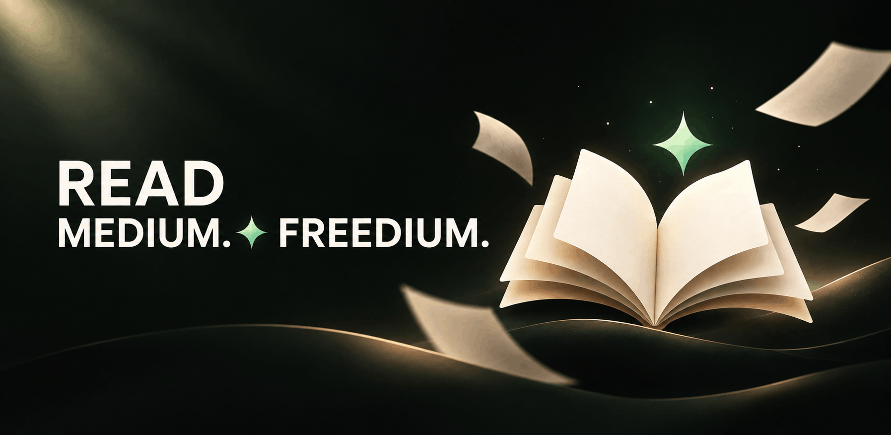
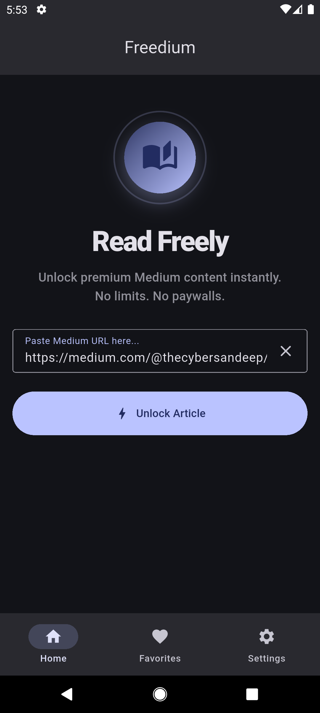
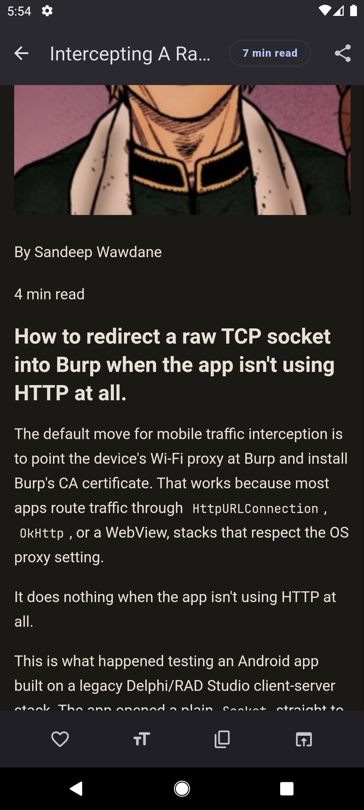
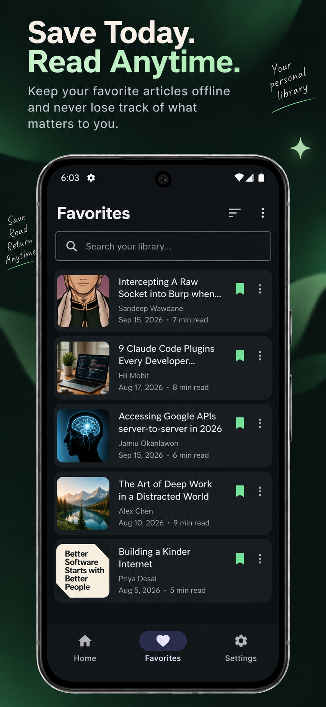
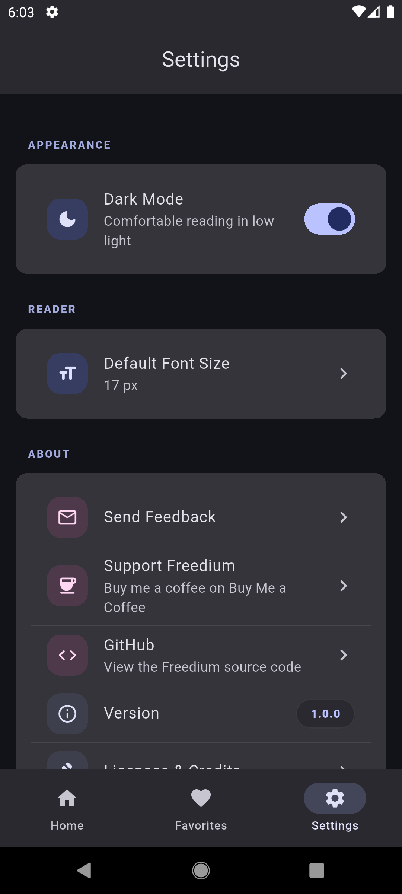
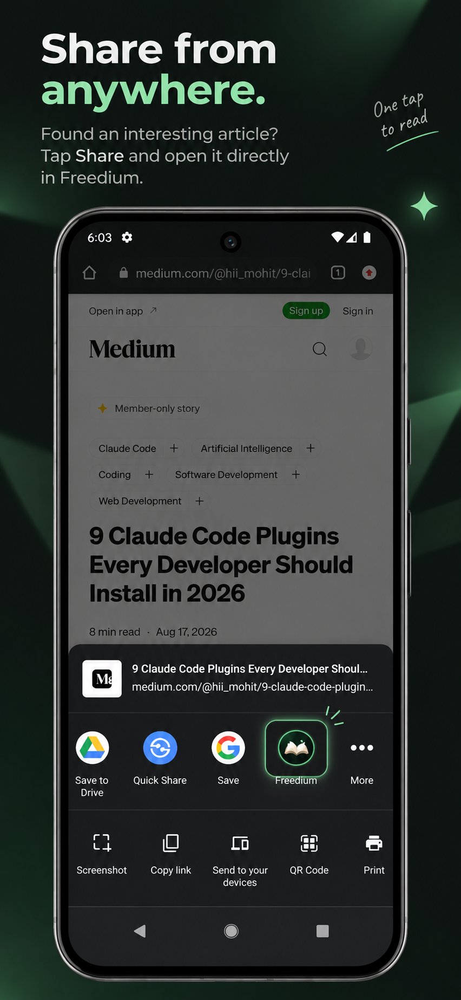

<div align="center">

# 📖 Freedium

**Read any Medium story — free, clean, and offline-ready.**

[](https://github.com/birmehto/Freedium/releases/latest)
[]()
[](LICENSE)
[](https://github.com/birmehto/Freedium/actions/workflows/ci.yml)
[](https://github.com/birmehto/Freedium/stargazers)



**Paste or share a Medium link, and Freedium opens the full story in a clean, comfortable reader** — no paywall, no clutter, no account.

[](https://github.com/birmehto/Freedium/releases/latest)

</div>

---

## ✨ Features

- **🛡️ Unlock any Medium story** — paste a link or share one from any app and read the whole article.
- **📚 Your Library** — Continue Reading, Favorites, Saved, and History, all in one place (with search).
- **💾 Read offline** — save any article and open it later without a connection.
- **🎨 Make it yours** — five reader themes (System, Light, Dark, Sepia, OLED) plus font family, font size, line height, paragraph spacing, content width, and text alignment.
- **🔎 Find in article** — search inside a story and jump between matches.
- **🔄 Reliable loading** — automatic mirror fallback with health tracking keeps articles coming when one source is down.
- **📊 Local reading statistics** — articles opened, completed, and minutes read, stored on-device only.
- **🔐 Truly private** — no account, no ads, no tracking. Everything stays on your device.

---

## 📱 Screenshots

    

---

## 🚀 Getting Started

**Prerequisites:** Flutter `>= 3.44.0` and Dart `>= 3.13.0` on the stable channel.

```bash
# Clone the repository
git clone https://github.com/birmehto/Freedium.git
cd Freedium

# Install dependencies
flutter pub get

# Run on a connected device or emulator
flutter run
```

> After changing a Drift table definition, regenerate the database code with `dart run build_runner build`.

### 📲 Download

| Platform | Get it |
|----------|--------|
| 🤖 **Android** | [Download the latest APK](https://github.com/birmehto/Freedium/releases/latest) |
| 🍎 **iOS** | Build from source — see [CONTRIBUTING.md](CONTRIBUTING.md) |

> On Android, enable "Install unknown apps" for your browser to install the APK.

---

## 🛠 Tech Stack

| Layer | What we use |
|-------|-------------|
| Framework | Flutter / Dart |
| State management | GetX (controllers, bindings, routing) |
| UI | Material 3 Expressive (`material_3_expressive`) |
| Article rendering | `flutter_inappwebview` with injected reader CSS/JS |
| Local storage | Drift + SQLite behind a `KeyValueStore` abstraction |
| Share integration | `receive_sharing_intent` (Share → Freedium) |
| Utilities | `url_launcher`, `share_plus`, `intl`, `package_info_plus` |
| Quality | `flutter_lints`, 101 unit/widget tests, GitHub Actions CI (format → analyze → test → Android debug build) |

---

## 🗺️ Roadmap

Planned items are clearly marked below — nothing here is claimed to ship yet.

### ✅ Current
Freedium today ships: unlock & read Medium articles, Library (favorites, history, saved, continue reading), offline reading, reader customization, find-in-article, automatic mirror fallback, themes, keyboard shortcuts, and local reading statistics.

### 🚧 Next
- **Bookmarks** — additionally bookmark articles in the Library *(planned, not yet implemented)*.
- **Animations** — subtle transitions for favorite, loading, and library updates *(planned)*.
- **Window-size handling & desktop testing** for Linux/macOS/Windows *(planned)*.

### 🔭 Future
- Better cross-platform desktop experience.
- Deeper search and discovery across saved content.
- See the full plan in [ROADMAP.md](ROADMAP.md).

---

## 🤝 Contributing

Contributions are welcome! Whether it's a bug fix, a UI polish, or a documentation improvement — please read [CONTRIBUTING.md](CONTRIBUTING.md) first.

Quick start for contributors:

1. Fork the repo and create a branch (`feat/...` or `fix/...`).
2. Make focused changes that follow the existing architecture.
3. Keep the quality bar green:
   ```bash
   dart format --set-exit-if-changed lib test
   flutter analyze
   flutter test
   ```
4. Open a pull request against `main` and describe what you changed.

Looking for something to work on? Check the issues labeled [`good first issue`](https://github.com/birmehto/Freedium/contribute).

---

## 🐛 Issues

- **🐞 Report a bug** — use the [Bug report](https://github.com/birmehto/Freedium/issues/new?assignees=&labels=bug&projects=&template=bug_report.yml) template. Include steps to reproduce, expected vs. actual behavior, and your device/Flutter version.
- **💡 Request a feature** — use the [Feature request](https://github.com/birmehto/Freedium/issues/new?assignees=&labels=enhancement&projects=&template=feature_request.yml) template and describe the problem you're trying to solve.

Before opening a new issue, please search existing issues to avoid duplicates.

---

## ⭐ Support

Freedium is free and open-source, built and maintained in spare time. If you find it useful:

- ⭐ **[Star the repo](https://github.com/birmehto/Freedium/stargazers)** — it helps others discover the project.
- ☕ **[Buy me a coffee](https://buymeacoffee.com/birmehto)** — helps keep the mirrors running.

---

## 📚 Learn more

- 🧭 [How it works](ARCHITECTURE.md) — architecture and tech stack
- 🤝 [Contributing](CONTRIBUTING.md) — build instructions and guidelines
- 🗺️ [Roadmap](ROADMAP.md) — what's next
- 📝 [Changelog](CHANGELOG.md) — release history
- 🔒 [Privacy](PRIVACY_POLICY.md) — what stays on your device

---

## ⚖️ Legal

Freedium is **not affiliated with, endorsed by, or connected to Medium or Freedium**. It wraps publicly available reader endpoints; all article content remains the property of its original authors.

Open-source under the [MIT License](LICENSE). © Bir Mehto.