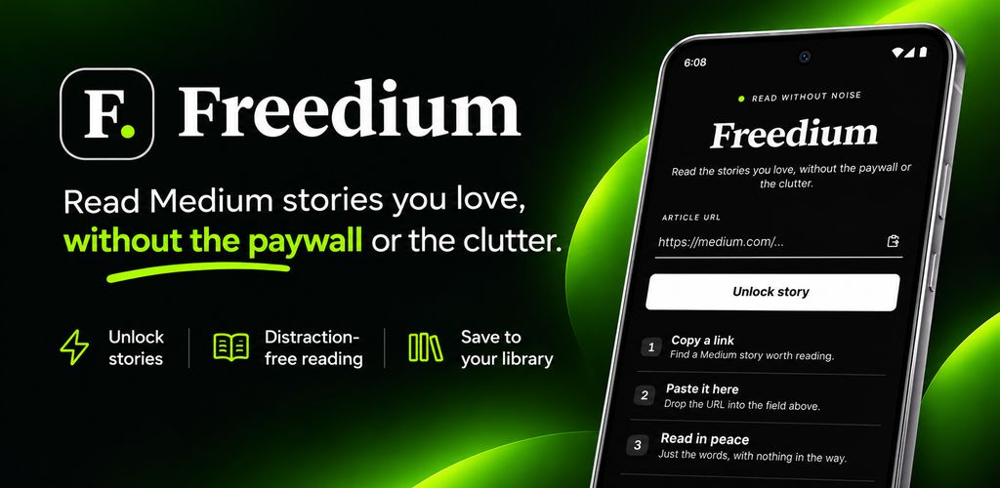
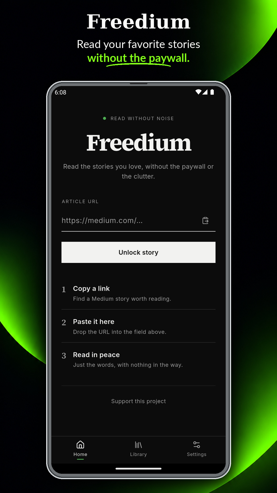
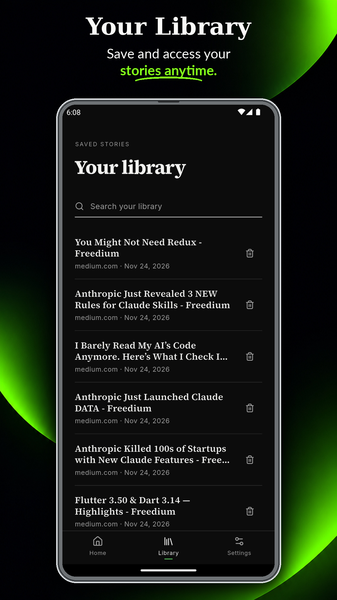
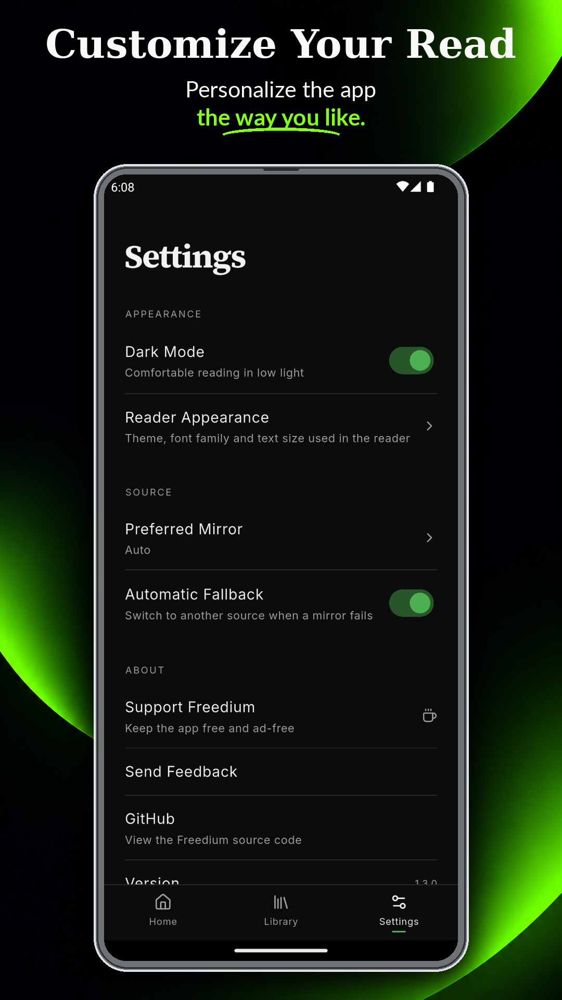
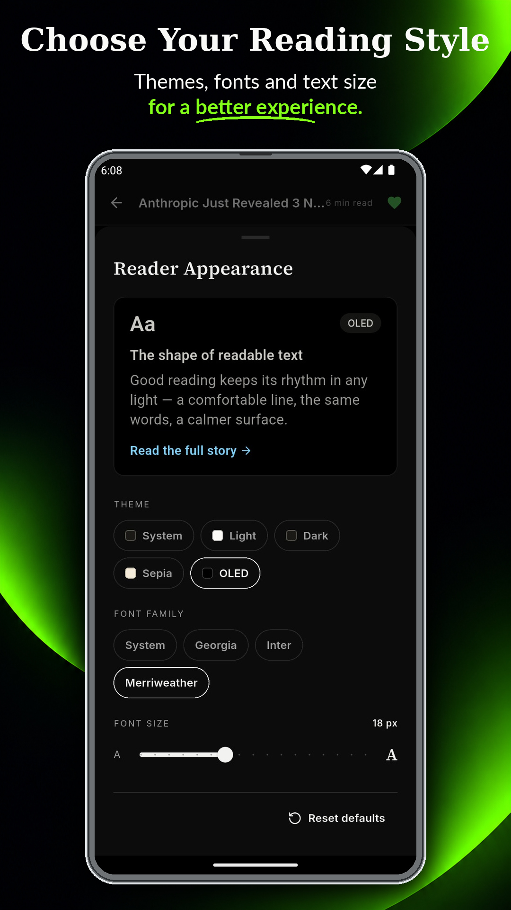
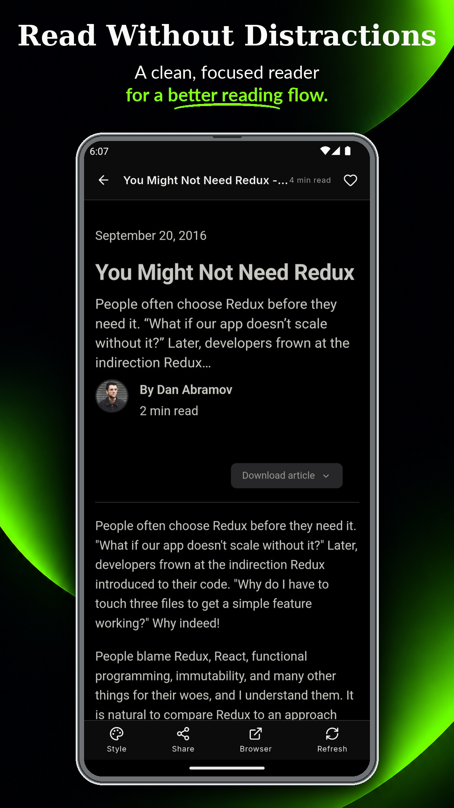
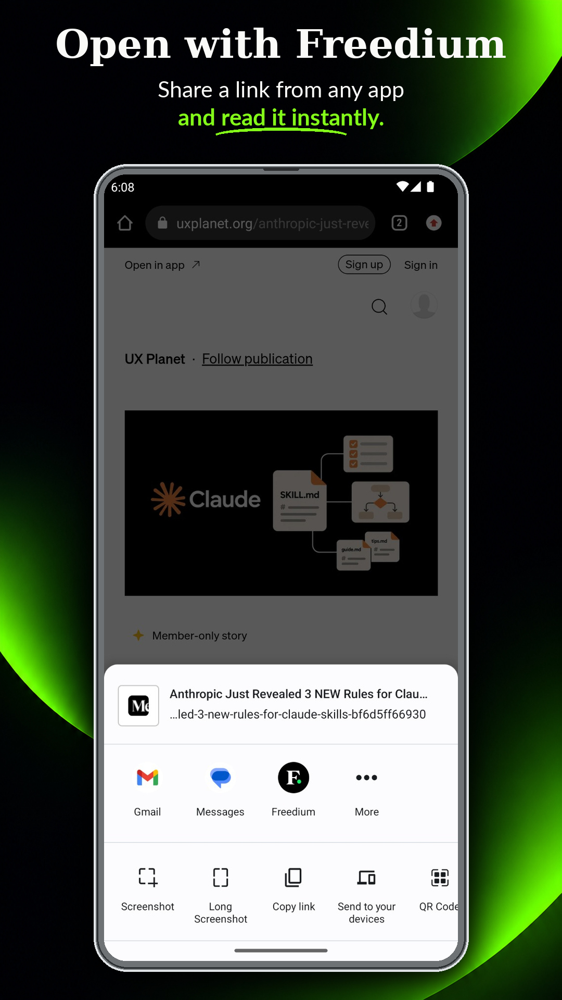

<div align="center">

# 📖 Freedium

**Read any Medium story — free, clean, and distraction-free.**

[](https://github.com/birmehto/Freedium/releases/latest)
[](https://github.com/birmehto/Freedium/releases/latest)
[](LICENSE)
[](https://github.com/birmehto/Freedium/stargazers)



**Paste or share a Medium link, and Freedium opens the full story in a freshly redesigned, distraction-free reader** — no paywall, no clutter, no account.

⭐ **[Star the repo](https://github.com/birmehto/Freedium/stargazers)** — it is the single best way to help new readers discover Freedium.

<p align="center">
  <a href="https://github.com/birmehto/Freedium/releases/latest"></a>
  &nbsp;
  <a href="https://play.google.com/store/apps/details?id=com.bir.freedium"></a>
</p>

</div>

---

## 🎯 What matters

- **Your reading stays yours.** No account, no analytics, no ads. Favorites, settings and saved stories stay on your device — no cloud sync. Opening a story only sends its link to the mirror that fetches it.
- **A story, not a webpage.** The reader strips the paywall and the clutter, then gives you five themes, font families and text size so long-form writing stays easy to read.
- **Redesigned from top to bottom.** An editorial masthead, Lucide icons, quiet motion and cleaner spacing make every screen feel calm and intentional.
- **It keeps working.** Five sources with automatic fallback and health tracking. Favorited stories are saved on-device, so a story you care about is still readable when every mirror is down.
- **Smaller and faster.** Tighter R8 rules removed 41% of DEX classes and shrank the universal APK to roughly 58 MB.
- **Free and open source.** MIT licensed, built in spare time. A coffee is appreciated, never required.

---

## ✨ Features

- **🛡️ Unlock any Medium story** — paste a link or share one from any app.
- **🖌️ Redesigned interface** — editorial masthead, Lucide icons, calmer spacing and one shared motion system.
- **⚡ Lean release build** — minimized R8 rules keep the app small without breaking any plugin.
- **⭐ Favorites** — a searchable on-device library of the stories you keep.
- **📥 Offline reading** — favoriting a story keeps a copy for offline use; removing the favorite removes the copy.
- **🎨 Make it yours** — System, Light, Dark, Sepia and OLED reader themes, plus font family and size.
- **🔄 Reliable loading** — Freedium Mirror, Freedium Web, Freedium backup, Archive.ph and Archive.is, with automatic fallback.
- **🎬 Quiet motion** — one shared animator keeps page transitions, tab swaps and toggles consistent.
- **⭐ Rate us** — rate the app or buy a coffee from the support dialog on Home or in Settings.
- **☕ Support the project** — an optional "buy me a coffee" from the home screen.

---

## 📱 Screenshots

| Home | Library | Settings |
|:---:|:---:|:---:|
|  |  |  |

| Reader appearance | Article reader | Share integration |
|:---:|:---:|:---:|
|  |  |  |

---

## 🛠 Build from source

**Prerequisites:** Flutter `>= 3.50` and Dart `>= 3.14` on the stable channel.

```bash
git clone https://github.com/birmehto/Freedium.git
cd Freedium

flutter pub get
dart run build_runner build   # generate Drift database code
flutter run
```

> Re-run `dart run build_runner build` after changing a Drift table.

---

## 🛠 Tech Stack

| Layer | What we use |
|---|---|
| Framework | Flutter / Dart |
| State management | Riverpod notifiers |
| UI | Material widgets with Lucide icons (`lucide_icons_flutter`) |
| Motion | One shared `AppAnimator` for routes, tabs and state changes |
| Article rendering | `webview_flutter` with injected reader CSS/JS |
| Local storage | Drift + SQLite behind a `KeyValueStore` abstraction |
| Share integration | `receive_sharing_intent` (Share → Freedium) |
| Utilities | `url_launcher`, `share_plus`, `intl`, `package_info_plus` |
| Quality | `flutter_lints`, 344 unit/widget tests |

---

## 🗺️ Roadmap

Shipped already: unlock & read, favorites, offline copies, reader customization, five-source fallback, app themes, consistent motion and the redesigned UI.

Next up:

- **Bookmarks** alongside favorites in the Library *(planned)*.
- **Window-size handling and desktop testing** for Linux/macOS/Windows *(planned)*.
- **Deeper search** across saved content *(planned)*.

Track progress in the repository issues and pull requests.

---

## 🤝 Contributing

Contributions are welcome — bug fixes, UI polish and documentation all help. Read [CONTRIBUTING.md](CONTRIBUTING.md) first.

1. Fork the repo and create a branch (`feat/...` or `fix/...`).
2. Make focused changes that follow the existing architecture.
3. Keep the quality bar green:
   ```bash
   dart format --set-exit-if-changed lib test
   flutter analyze
   flutter test
   ```
4. Open a pull request against `main` and describe what you changed.

Looking for a starting point? Check the [`good first issue`](https://github.com/birmehto/Freedium/contribute) label.

---

## 🐛 Issues

- **🐞 Report a bug** — use the [Bug report](https://github.com/birmehto/Freedium/issues/new?assignees=&labels=bug&projects=&template=bug_report.yml) template. Include steps to reproduce, expected vs. actual behavior, and your device/Flutter version.
- **💡 Request a feature** — use the [Feature request](https://github.com/birmehto/Freedium/issues/new?assignees=&labels=enhancement&projects=&template=feature_request.yml) template and describe the problem you're solving.

Please search existing issues first to avoid duplicates.

---

## ⭐ Support

Freedium is free and open source, built and maintained in spare time. If it's useful to you:

- ⭐ **[Star the repo](https://github.com/birmehto/Freedium/stargazers)** — it helps others find it.
- ☕ **[Buy me a coffee](https://buymeacoffee.com/birmehto)** — helps keep the mirrors running.

---

## 📚 Learn more

- 🤝 [Contributing](CONTRIBUTING.md) — build instructions and guidelines
- 📝 [Changelog](CHANGELOG.md) — release history
- ⚖️ [Third-party notices](THIRD_PARTY_NOTICES.md) — library, font and content attributions
- 🔒 [Privacy](PRIVACY_POLICY.md) — what stays on your device

---

## ⚖️ Legal & credits

Not affiliated with Medium. Stories belong to their authors — we just hold the door open. MIT licensed, © 2025–2026 Bir Mehto.

The long version (libraries, fonts, mirrors and the rest) lives in [THIRD_PARTY_NOTICES.md](THIRD_PARTY_NOTICES.md). The short, funny version is in the app under **Settings → Licenses & Credits**.
