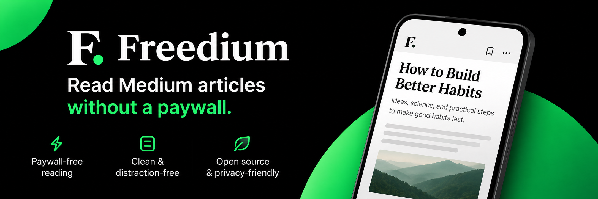

## ✨ What's New in v1.1.5

- **🚫 Pure ad-free experience** — all Google Mobile Ads and tracking dependencies have been completely removed.
- **📚 Offline reading** — favoriting an article keeps an offline copy on your device so it opens instantly without an internet connection.
- **📈 Reading progress** — automatically remembers your reading position per article, visible in the reader and surfaced in Favorites.
- **🛰️ Mirror failover** — multi-mirror bypass servers with health tracking and automatic fallback when a mirror is unreachable.
- **🎨 Reader customization**:
  - **Readability themes** — System / Light / Dark / Sepia / OLED.
  - **Typography controls** — custom font family and font size options.
  - **Article metadata** — instant extraction of titles, authors, publication details, word counts, and estimated reading times.
  - **Quick actions** — favorite, share, copy link, and open in browser.
- **🌗 Full-app theme support** — seamless System, Light, and Dark modes across all screens.
- **⚙️ Architectural improvements**:
  - Upgraded to modern Drift SQLite database storage for bookmarks, reading progress, and settings.
  - Standardized on Flutter Material snackbars and Material 3 Expressive UI components.
  - Migrated reader engine to official `webview_flutter`.
  - Clean APK builds without requiring private keystore keys for direct downloads.

## 🐛 Fixes & Polish

- Dark/Light theme switching responds instantaneously across all screens.
- Reader load progress now dismisses immediately once article content becomes visible.
- Removed unused dependencies and obsolete environment configurations.

## 📥 Installation

- **Google Play:** Install and receive automatic updates from [Google Play](https://play.google.com/store/apps/details?id=com.bir.freedium).
- **Direct APK:** Download `Freedium-v1.1.5-universal.apk` (or your device's architecture APK such as `arm64-v8a`) directly from the release assets below.